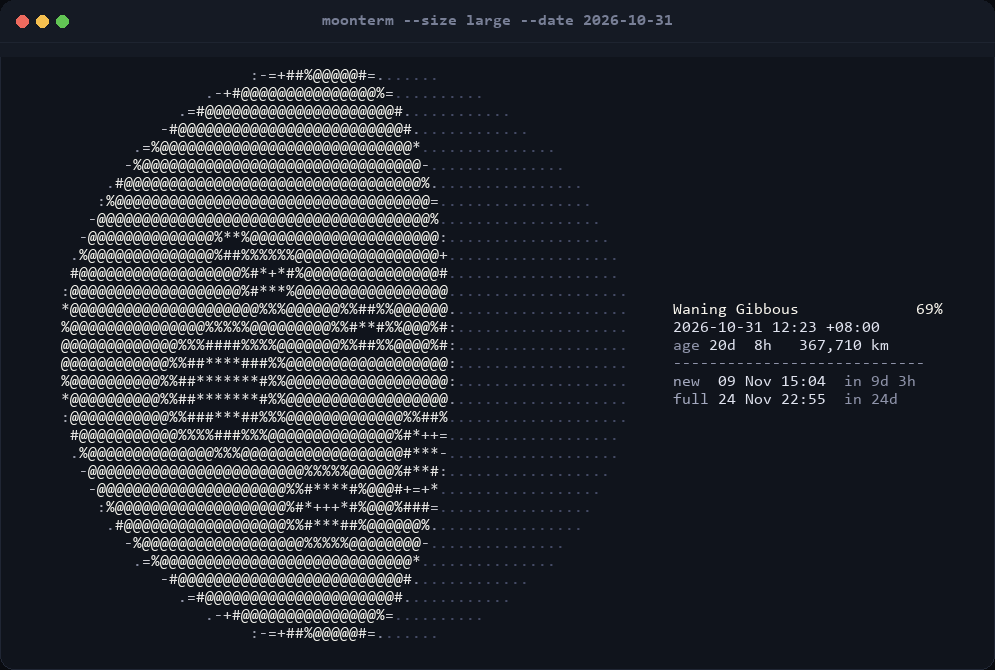

# moonterm

[](https://github.com/yqlwb12/moonterm/actions/workflows/ci.yml)

> **Experimental project, for reference and learning only.**
> Published as-is, with no warranty of correctness or fitness for purpose.
> 本项目仅供参考与实验用途，不保证可靠性；生产使用前请自行充分测试。

**Tonight's moon, drawn in your terminal.** Pure Python, no dependencies, ASCII on the way out.



## Why

`cal` tells you the date. `date` tells you the time. Neither tells you what the sky
is doing, and `curl wttr.in/moon` needs the network. This is ~950 lines of Python
that computes the phase from the ephemeris and draws it, so `moonterm` works on a
plane, in a container, and in a `watch`.

## Features

- **Real astronomy**, not a lookup table: the Moon's position comes from the
  truncated ELP-2000/82 series (Meeus ch. 47), the Sun's from ch. 25. Phase times
  land within a few minutes of the Astronomical Almanac.
- **A real terminator.** The day/night boundary is drawn as the ellipse it projects
  to, 4×4 supersampled, so crescents taper instead of stepping.
- **Maria.** The near-side dark patches are placed by hand at roughly their true
  selenographic positions, so a full moon looks like *the* Moon and not a white blob.
- **Nothing to install but Python.** Standard library only, 3.9+.
- **ASCII output** — safe in any terminal, in CI logs, over SSH, in a `less` pager.
- **Colour when you want it** (24-bit, auto-disabled when piped), `--json` when you
  want numbers, `--watch` when you want it to tick over.

## Install

```console
$ pip install .
$ moonterm
```

Or without installing, straight from the checkout:

```console
$ PYTHONPATH=src python -m moonterm
```

## Usage

```console
$ moonterm                          # tonight, medium size
$ moonterm --date 2026-05-01        # any date
$ moonterm -d 2026-12-24T22:00 -s large
$ moonterm -d +3d                   # relative: s, m, h, d, w
$ moonterm --south                  # southern hemisphere view
$ moonterm --art-only               # no panel, just the moon
$ moonterm --json | jq .illumination
$ moonterm --watch 60               # redraw every minute
```

| Option | Meaning |
| --- | --- |
| `-d, --date WHEN` | `2026-05-01`, `2026-05-01T21:30`, `now` (default), `+3d`, `-12h` |
| `-s, --size` | `small` (25 cols), `medium` (43), `large` (71) |
| `-w, --width COLS` | exact width in columns, overrides `--size` |
| `--south` | mirror the disc for southern-hemisphere observers |
| `--json` | machine-readable phase data |
| `--plain`, `--no-color` | never emit ANSI |
| `--color` | force colour even when piped |
| `--no-earthshine` | leave the unlit limb empty instead of faintly dotted |
| `--no-texture` | smooth moon, no maria |
| `--art-only` | print the moon without the info panel |
| `--watch [SECONDS]` | live redraw, default 2 s |

Plain output is pure ASCII, panel included — safe in logs, pipes and pageants:

```text
                :==##%@@@%*:.....
            .=#@@@@@@@@@@@@@+........
          -#@@@@@@@@@@@@@@@@@*.........
        -%@@@@@@@@@@@@@@@@@@@@-..........
      .#@@@@@@@@@@@@@@@@@@@@@@%............
     :%@@@@@@@@@@@@@@@@@@@@@@@@=............
    :%@@@@@@@@@##@@@@@@@@@@@@@@#.............
    #@@@@@@@@@@%%%##%@@@@@@@@@@@.............
   =@@@@@@@@@@@@@#**%@@@@@@@@@@@-.............
   #@@@@@@@@@@@@@@@@@@@@%###%@@@=.............
   @@@@@@@@@%%%#%%%@@@@@%##%@@@#-.............
   @@@@@@@@%##***##%@@@@@@@@@@@@=.............
   #@@@@@@@%#*****#%@@@@@@@@@@@@=.............
   =@@@@@@@%%##*##%%@@@@@@@@@%##:.............
    #@@@@@@@@%%%%%@@@@@@@@@@%#++.............
    :%@@@@@@@@@@@@@@@%%%%@@@%#**.............
     :%@@@@@@@@@@@@@%#++*#@@%*+-............
      .#@@@@@@@@@@@@%#**#%@@@@%............
        -%@@@@@@@@@@@@%%@@@@@@-..........
          -#@@@@@@@@@@@@@@@@@*.........
            .=#@@@@@@@@@@@@@+........
                :==##%@@@%*:.....

  Waning Gibbous             69%
  2026-10-31 12:23 +08:00
  age 20d  8h   367,710 km
  ----------------------------
  new  09 Nov 15:04  in 9d 3h
  full 24 Nov 22:55  in 24d
```

At new moon there is technically nothing to see. The unlit limb is drawn as a faint
`.` — earthshine — so the disc still reads as a disc instead of vanishing:

```console
$ moonterm -d 2026-11-09 -s small --art-only --plain
         .............
      ...................
    .......................
   .........................
   .........................
   .........................
   .........................
   .........................
   .........................
    .......................
      ...................
         .............
```

## Python API

```python
>>> from datetime import datetime, timezone
>>> from moonterm import moon_phase
>>> phase = moon_phase(datetime(2026, 5, 1, tzinfo=timezone.utc))
>>> phase.name
'Waxing Gibbous'
>>> round(phase.percent, 1)
99.5
>>> round(phase.age_days, 1)      # days since the last new moon
14.1
>>> phase.next_full_moon()
datetime.datetime(2026, 5, 1, 17, 26, 17, tzinfo=datetime.timezone.utc)
```

Lower-level pieces live in `moonterm.astro` (`julian_day`, `elongation`,
`illumination`, `next_new_moon`, `next_full_moon`) and `moonterm.render`
(`moon_lines`, `shade`).

## How it works

1. **Time.** `--date` becomes a Julian Day. Naive input is local time.
2. **Two longitudes.** Evaluate the Sun's and the Moon's geocentric ecliptic
   longitudes at that instant. Their difference is the elongation ψ; nutation
   cancels in the subtraction, so it never has to be computed.
3. **Phase.** ψ = 0° is new, ψ = 180° is full, and the illuminated fraction is
   `(1 − cos ψ) / 2`. The phase index is ψ/360 (eastward), which is also the
   fraction of the synodic month elapsed.
4. **Draw.** For each character cell, test 16 sub-pixels against the disc and
   against the terminator `u = cos(2π·phase)·√(1 − v²)`, count the lit ones, and
   pick a ramp character from the coverage. Multiply by the maria albedo.

Deeper notes, including why the terminator is an ellipse, are in
[docs/DESIGN.md](docs/DESIGN.md).

## Accuracy

Checked in the test suite against Meeus' worked examples and published phase times:

| Quantity | Agreement |
| --- | --- |
| Lunar longitude | ~0.01° |
| Sun–Moon elongation | ~0.02° |
| Moon distance | ~20 km |
| New / full moon times | ~3 minutes |

Which is to say: better than the drawing. Parallax, topocentric correction, and
libration are deliberately ignored — a terminal moon at 43 columns does not care,
and pretending otherwise would need a 200-line series.

## Development

```console
$ PYTHONPATH=src python -m unittest discover -s tests -v
```

50 tests, standard library only, no test dependencies. CI runs them on Python
3.9–3.13 across Linux, macOS and Windows.

## Disclaimer

This repository is a personal experiment, published for reference and learning.
It is not production software.

- **No warranty.** Provided "as is", without warranty of any kind, exactly as the
  licence says. Correctness, fitness for purpose and safety are not guaranteed.
- **Expect changes.** Interfaces, output formats and behaviour may change without
  notice; the test suite describes what the code does today, not a promise about
  tomorrow.
- **Verify before you rely on it.** Read the code, run the tests, and check the
  results yourself in your own environment.

The geometry is an approximation: good enough to draw a moon, not good enough for navigation, observation planning, or anything that needs a documented ephemeris.

本项目仅供学习、参考与实验使用，作者不对其可靠性、准确性与适用性作出任何保证。
在生产环境使用或对外提供服务之前，请自行充分审查代码、评估风险并完成测试。

## License

MIT.
